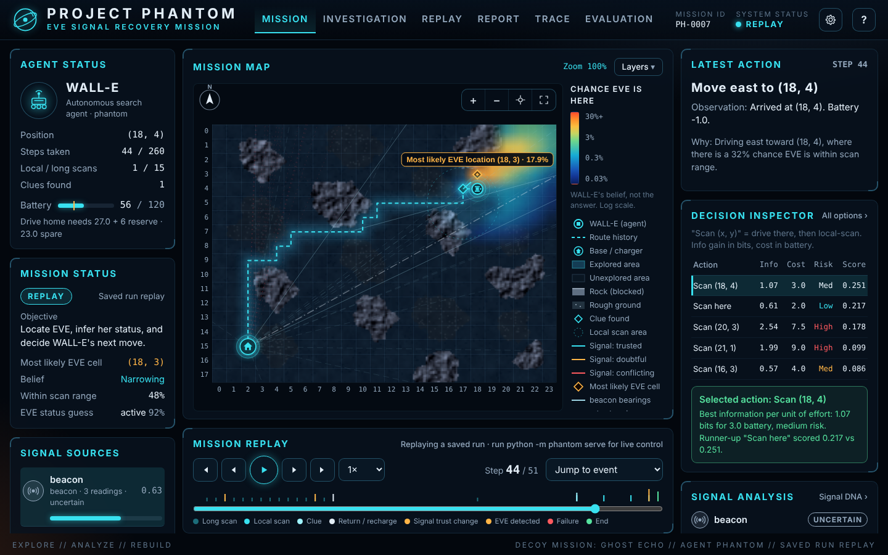

# EVE SIGNAL // PROJECT PHANTOM

An explainable autonomous search agent for the **WALL-E and EVE's Signal** challenge. WALL-E explores a simulated terrain map, gathers clues and noisy signals, manages a limited battery and time budget, and works out where EVE is, what state she is in, and what to do next. Every decision is logged and can be replayed in a browser.

PHANTOM is a **heuristic, probabilistic agent**: a Bayes-filter belief grid plus a hand-designed scoring rule. It does not use machine learning or neural networks, and it does not call an LLM.



---

## 1. The problem

A mission config describes a map (or a seed to generate one), an initial signal reading (direction or coordinates, strength, timestamp), a resource budget (battery, time, action costs) and clue placement (or a seed). The agent must find EVE by interacting with the world: it only learns where clues are by scanning near them, and it only learns where EVE is from noisy evidence. It must not run out of battery away from base.

## 2. How to run

Requires Python 3.10+.

```bash
pip install -r requirements.txt

# run one mission: prints an ASCII map, writes trace + report, refreshes the UI data
python -m phantom run configs/sample_mission.yaml
python -m phantom run configs/decoy_mission.yaml

# try a baseline agent on the same mission
python -m phantom run configs/decoy_mission.yaml --agent sweep      # or random, phantom_no_dna

# check a config without running it
python -m phantom validate configs/sample_mission.yaml

# benchmark against baselines on seeded random missions (takes ~6 minutes)
# note: this overwrites outputs/benchmark.* and the Evaluation screen's data,
# so a quick test with fewer seeds replaces the saved 20-seed results
python -m phantom bench --seeds 20

# tests
python -m pytest -q
```

**Open the interface**, two ways:

```bash
# A. live mission console (recommended for demos): Start / Pause / Step / Reset and the
#    configuration screen drive the real simulation
python -m phantom serve            # then open http://127.0.0.1:8765
                                   # port busy? python -m phantom serve --port 8766

# B. replay only, no server: double-click ui/index.html
#    it replays the last mission you ran with `python -m phantom run ...`
```

## 3. The mission console

Six screens, one console. Every number, route, heatmap cell and score is read from the simulation trace; nothing is mocked.

| Screen | What it shows |
| --- | --- |
| **Mission** | Large terrain map (rock, rough ground, explored vs unexplored, coordinates, base, route, clues, scan areas, signal bearings, belief heatmap with "most likely EVE cell"), agent status and battery with the drive-home threshold, mission status, signal sources with learned reliability, recent log, latest action (what, observation, why), decision inspector, signal analysis, mission phase and confidence over time |
| **Investigation** | Signal DNA per source (reliability, 90% range, agreement counts, where the source alone points), all Ghost Decisions with vetoes, evidence added at this step, belief before/after with a live check that probabilities are finite, non-negative and sum to 1 |
| **Replay** | Full-width cinematic replay of the saved trace: map fills the frame, caption with the step's action and reason, battery and best guess, and a video-player timeline with event dots (cyan = already happened, amber = still to come) and a draggable playhead. WALL-E glides between cells; **Follow** keeps the camera on him; **Record** plays the whole mission and saves it as a `.webm` video. A recorded example is in `docs/mission-replay.mp4` |
| **Report** | Inferred location and confidence, status, resources, recommended next step (labelled as a recommendation), strongest and contradictory evidence linked to their steps, signal trust, remaining uncertainty, report.json / trace.jsonl export, and an evaluation-only ground-truth section behind an explicit switch |
| **Trace** | Every event with action, observation, uncertainty change, battery change and decision; filters; expandable plain-English explanation and raw JSON; trace.jsonl download |
| **Evaluation** | The saved benchmark: success rates with 95% ranges, all metrics, definitions, scenario settings and what the numbers do not prove. Shows "not run yet" instead of zeros when there is no benchmark |

The gear button opens **mission configuration** (live mode): preset map or seeded scenario, seed, agent, battery capacity and time budget, with defaults, limits and validation; settings go straight into the real environment config. In replay mode it explains how to go live and lets you load any `outputs/*/mission.json`. The **?** button has the guide, status meanings, keyboard shortcuts and run information.

The live server uses only the Python standard library and listens on 127.0.0.1. Hidden truth never leaves it until a mission is finished, and then only inside the trace's separate `evaluation` block. Finished live missions are saved to `outputs/live_<preset>_<agent>/`.

## 4. Outputs

Each `run` writes to `outputs/<config>_<agent>/`:

| File | What it is |
| --- | --- |
| `trace.jsonl` | One JSON line per event: header, start state, every action with its decision, observation, belief update and resources, then the report and the evaluation |
| `report.md`, `report.json` | Final mission report, generated **only from the trace** |
| `mission.json` | The whole trace in one file (what the UI loads) |

Committed samples: `outputs/sample_mission_phantom/` and `outputs/decoy_mission_phantom/` (plus baseline runs of the decoy mission for comparison).

## 5. Architecture

```
configs/*.yaml ──▶ config.py (load + validate)
                        │
                        ▼
                  world.py  Environment  ◀── the ONLY place hidden truth lives
                   │  public_info()            (EVE position/status, clue cells,
                   │  step(action) → Observation   true source reliability, decoys)
                   ▼
   agent.py  PhantomAgent  (sees only public info + observations)
     ├─ belief.py      BeliefModel   probability grid over (cell, status), Bayes updates
     ├─ signal_dna.py  SignalDNA     learned reliability per signal source
     └─ planner.py     Planner       Ghost Decisions: candidates, scores, safety vetoes
                   │
                   ▼
   mission.py  run loop + trace ──▶ report.py (report from trace only)
                   │                 benchmark.py (seeded comparisons)
                   ▼
   ui/  index.html + app.js  replay viewer (reads the trace, never the agent)
```

| File | Responsibility |
| --- | --- |
| `phantom/config.py` | Schema, validation with clear errors, seeded terrain/EVE/clue generation, benchmark scenarios |
| `phantom/world.py` | Environment: legal actions, costs, sensors, observations, stranding and time limits |
| `phantom/sensors.py` | Public sensor formulas shared by world and agent (bearing noise, beacon range) |
| `phantom/geometry.py` | Bearings, distances, Dijkstra path costs |
| `phantom/belief.py` | Belief grid and Bayes updates for every evidence type |
| `phantom/signal_dna.py` | Reliability learning (Beta counters), labels |
| `phantom/planner.py` | Candidate generation, information gain, scoring, safety rules |
| `phantom/agent.py` | Ties belief + DNA + planner together; plain-English explanations |
| `phantom/baselines.py` | Sweep and random baselines (same safety rules) |
| `phantom/mission.py` | Mission loop, trace, output files |
| `phantom/report.py` | Mission report from the trace |
| `phantom/benchmark.py` | Seeded benchmark with confidence intervals |
| `phantom/server.py` | Local live-console server: presets, config validation, step/finish API (stdlib only) |
| `ui/` | Mission console (HTML + Canvas, no build step, no dependencies) |
| `tests/` | 68 pytest tests |

## 6. The environment

* **Map:** a grid of plain (cost 1), rough (cost 2.5) and rock (impassable) cells, from ASCII rows in the config or generated from a seed. Movement is 4-directional.
* **Actions:** `move N/E/S/W`, `long_scan`, `local_scan`, `recharge` (only at base), `end_mission`. Every action takes 1 tick. Illegal actions (into rock, off the map, recharging away from base, not enough battery) are refused with an error and cost no battery, but still use the tick.
* **Long-range scan (4 battery):** each signal source reports. The *beacon* is only heard sometimes (more often if EVE is active and close) and gives a bearing and strength. A *relay* always answers with a bearing. For any source, with probability `1 - true_reliability` (hidden) the bearing is random, or points at a decoy; the sample configs set the beacon to 1.0.
* **Local scan (2 battery, radius 2):** the trusted short-range sensor. Detects EVE within range 90% of the time, reads her status correctly 85% of the time, and reveals any clues within range.
* **Clues:** *track* clues point toward EVE with 10° of Gaussian noise; *residue* clues hint at her status (fresh/cold) and whether she is near (within 8 cells), each right 85% of the time.
* **Ending:** the agent ends the mission, time runs out, or WALL-E is stranded (away from base with less battery than one move).

## 7. How the agent thinks

**Belief.** WALL-E keeps a probability for every (cell, status) pair, summing to 1. Each piece of evidence multiplies in a likelihood ("how likely is this reading if EVE were here?"), then the grid is renormalised: a discrete Bayes filter. A tiny floor means no cell is ever ruled out forever, so the belief can recover from a misleading reading. The heatmap is this grid summed over status.

**Ghost Decisions.** Every step the planner builds candidates: local scan here, long-range scan here, and "drive to X and local scan" for the few most promising X. Each gets:

```
info (bits)  expected drop in uncertainty about EVE (entropy)
             - local scan: computed exactly from the two outcomes (detect / no detect)
             - long-range scan: estimated by simulating 24 possible readings
score = info ÷ (battery cost + 0.5 × ticks) × (1 − 0.5 × risk)
risk  = how close the plan leaves WALL-E to the safety margin (0 safe … 1 at the limit)
```

A plan is **vetoed** if afterwards WALL-E could not drive home with the reserve left. The best-scoring feasible plan wins; a 10% bonus for continuing toward the current target prevents dithering. All candidates, scores and vetoes are logged: the rejected ones are the "ghosts".

**Safety rules** (logged as `forced_by` when they override the score): turn back when time is nearly out; return home when every useful plan is vetoed; recharge at base when a plan that is blocked only by battery (and would fit a full battery) scores better than anything affordable; end when nothing is both safe and worthwhile.

**Signal DNA.** Each long-range source has a Beta(a, b) counter; reliability = a ÷ (a + b), used as the mixing weight in that source's likelihood. Readings are judged against an **independent reference belief** built only from evidence no long-range source produced (empty scans, physical clues, the age-discounted initial signal), so a source never grades itself and sources never grade each other. A reading is judged only once that reference has a real directional opinion from the reading's position. When a local scan sees EVE, every past reading is re-scored against her confirmed cell. Labels: *trusted* (90% range above 0.6), *conflicting* (90% range below 0.45 after at least 4 judged readings), *doubtful*, *uncertain*. The initial signal's trust halves every 120 minutes of age (shown as *stale* below 50%).

**Established vs ours.** Bayes filters, Beta-Bernoulli reliability and entropy-based information gain are textbook techniques. Our contribution is how they are combined here: the independent-reference rule for Signal DNA, the logged candidate scoring, and a replay that shows the agent's real numbers.

## 8. Configuration

See `configs/sample_mission.yaml` (fully commented). Sections:

| Section | Keys | Visible to agent? |
| --- | --- | --- |
| `mission` | `name`, `seed`, `start_time` | yes |
| `map` | `rows` (`.` `~` `#` `B`) **or** `width`, `height`, `generate: {seed, rock_density, rough_density}`; `base` | yes |
| `resources` | `battery_capacity`, `start_battery`, `time_budget`, `reserve`, `costs: {move_plain, move_rough, long_scan, local_scan, recharge_rate}` | yes |
| `initial_signal` | `origin`, `bearing_deg` **or** `coordinates`, `strength`, `timestamp`, `noise_deg` | yes |
| `sensors.local_scan` | `radius`, `detect_prob`, `status_accuracy` | yes |
| `sensors.sources.<name>` | `kind` (`beacon`/`relay`), `noise_deg`, beacon `range`, `emit_active`, `emit_dormant` | yes |
| `sensors.sources.<name>` | `true_reliability`, `decoy` | **no (hidden)** |
| `eve` | `position`, `status` (omit for seeded) | **no (hidden)** |
| `clues` | `items: [{type, position}]` or `generate: {seed, count}` | **no (hidden)** |
| `agent` | `status_prior_active`, `dna_prior`, `initial_signal_trust`, `staleness_half_life_min`, `use_signal_dna` | yes |

Invalid configs stop with a specific message, for example `CONFIG ERROR: eve.position [19, 1] is on rock or unreachable from base`.

## 9. Sample trace and report

One trace line (step 32 of the sample mission, trimmed to 3 of its 11 candidates). The candidates were scored at (15, 5) before the step; `position` is where WALL-E is after the move:

```json
{"step": 32, "position": [16, 5], "battery": 64.0,
 "decision": {
   "candidates": [
     {"label": "Local scan here (15, 5)", "eig_bits": 0.6683, "battery_cost": 2.0, "time_cost": 1, "risk": 0.0, "score": 0.26733},
     {"label": "Long-range scan from (15, 5)", "eig_bits": 0.7601, "battery_cost": 4.0, "time_cost": 1, "risk": 0.0, "score": 0.16891},
     {"label": "Drive to (18, 5) and local scan", "eig_bits": 1.9022, "battery_cost": 5.0, "time_cost": 4, "risk": 0.067, "score": 0.2889, "commit_bonus": true, "chosen": true}],
   "reason": "Drive to (18, 5) and local scan: expects 1.902 bits of information for 5.0 battery and 4 ticks (score 0.2889); runner-up 'Local scan here (15, 5)' scored 0.2673",
   "plain_english": "Driving east toward (18, 5), where there is a 35% chance EVE is within scan range."},
 "observation": {"action": {"type": "move", "direction": "E"}, "ok": true, "battery_delta": -1.0, "time_left": 228},
 "belief_update": {"entropy_before": 7.0073, "entropy_after": 7.0073, "info_gained_bits": 0.0}}
```

Final report (`outputs/sample_mission_phantom/report.md`, abridged):

> **Outcome:** EVE located at (19, 3), confirmed by a local scan. Status **active** (98% confidence).
> **Evidence:** local scan detected EVE at step 37 (status reading active); residue clue at (15, 6) (fresh, EVE far); track clue at (17, 4) pointing 74.3°; 8 relay bearings, 1 beacon bearing, 7 silent beacon scans.
> **Signal DNA:** relay 0.58 (90% range 0.35–0.80, true value 0.55, revealed only in evaluation).
> **Resources:** 38 actions, 63 battery spent, 57 left, never below the safety margin.
> **Next step:** drive to EVE at (19, 3) (2 moves, about 2 battery) and attempt contact.

Note the residue clue said "far" although EVE was 4 cells away: clues are only 85% accurate, and the agent treats them that way.

## 10. Benchmark

`python -m phantom bench --seeds 20` generates 20 random missions for each of 5 scenarios (24×18 maps, seeded terrain, EVE, clues and signals) and runs four agents on the **same** missions:

* `phantom`: the full agent
* `phantom_no_dna`: the same agent with Signal DNA switched off (every source trusted at a fixed 0.8). This is the honest test of Signal DNA.
* `sweep`: checks scan spots along the initial signal, then sweeps the map
* `random`: random moves, a local scan every 4 moves

All four use the same safety rules. **Success** = a local scan confirmed EVE at her true cell. Steps are averaged over successful runs only. Ground truth is used only after each run, for scoring.

| Scenario | Agent | Success | 95% CI | Steps when found | Battery spent | Stranded | P(true cell) | Status right |
| --- | --- | --- | --- | --- | --- | --- | --- | --- |
| clean | phantom | 100% | 84%–100% | 34.1 | 55.4 | 0 | 1.00 | 95% |
| clean | phantom_no_dna | 100% | 84%–100% | 37.0 | 62.1 | 0 | 1.00 | 95% |
| clean | sweep | 50% | 30%–70% | 75.2 | 186.0 | 0 | 0.68 | 90% |
| clean | random | 5% | 1%–24% | 211 | 340.3 | 0 | 0.06 | 50% |
| noisy | phantom | 100% | 84%–100% | 42.9 | 63.0 | 0 | 1.00 | 90% |
| noisy | phantom_no_dna | 100% | 84%–100% | 38.5 | 62.3 | 0 | 1.00 | 100% |
| noisy | sweep | 50% | 30%–70% | 75.2 | 186.0 | 0 | 0.68 | 90% |
| noisy | random | 5% | 1%–24% | 211 | 340.3 | 0 | 0.06 | 50% |
| unreliable | phantom | 100% | 84%–100% | 50.9 | 81.3 | 0 | 1.00 | 100% |
| unreliable | phantom_no_dna | 100% | 84%–100% | 52.8 | 90.5 | 0 | 1.00 | 100% |
| unreliable | sweep | 40% | 22%–61% | 75.9 | 210.0 | 0 | 0.64 | 90% |
| unreliable | random | 0% | 0%–16% | – | 341.8 | 0 | 0.01 | 55% |
| decoy | phantom | 95% | 76%–99% | 63.4 | 116.5 | 0 | 0.95 | 95% |
| decoy | phantom_no_dna | 35% | 18%–57% | 88.6 | 193.9 | 0 | 0.45 | 95% |
| decoy | sweep | 50% | 30%–70% | 75.2 | 186.0 | 0 | 0.68 | 90% |
| decoy | random | 5% | 1%–24% | 211 | 340.3 | 0 | 0.06 | 50% |
| tight_battery | phantom | 100% | 84%–100% | 67.0 | 94.0 | 0 | 1.00 | 100% |
| tight_battery | phantom_no_dna | 90% | 70%–97% | 72.3 | 104.7 | 0 | 1.00 | 100% |
| tight_battery | sweep | 45% | 26%–66% | 102.6 | 199.4 | 0 | 0.58 | 95% |
| tight_battery | random | 0% | 0%–16% | – | 339.7 | 0 | 0.01 | 60% |

**What this shows.** In this simulator PHANTOM confirmed EVE in 99 of 100 missions while using fewer actions and less battery than the sweep baseline, and no agent was ever stranded. Signal DNA made a clear difference only in the **decoy** scenario (95% vs 35% success with it switched off). In the clean, noisy and unreliable scenarios the full agent and the no-DNA version are within noise of each other; in the noisy scenario the no-DNA version was even slightly faster.

**What it does not show.** 20 runs per row gives wide 95% ranges, so small differences mean nothing. All scenarios use our own sensor model and map size; the organisers' configs could behave differently. The clean, noisy and decoy rows share the same maps and initial signals per seed (only the long-range sources change), which is why the sweep and random rows repeat: they ignore those sources.

## 11. Tests

`python -m pytest -q` runs 68 tests covering: config validation and error messages; seeded reproducibility; move/scan/recharge costs; rock, edge and battery refusals; stranding and time limits; no hidden truth in public info or observations; agent modules never importing the environment; identical first decisions when only hidden truth changes; belief normalisation and the probability floor; empty-scan and detection updates; triangulation; Signal DNA ranking a decoy below honest sources and never labelling an honest source "conflicting" (8 seeded decoy missions); scores matching the documented formula; vetoes matching the reserve rule; zero strandings across 54 seeded runs; byte-identical traces for the same seed; replay reconstruction (positions, battery, belief) from the trace; the report rebuilt from the trace alone; the step-by-step runner producing byte-identical traces to a full run; the live API (session, step, finish), its input validation and that it never returns hidden truth before a mission ends.

The interface was also checked in a headless browser: 51 automated checks in replay mode (every transport control, scrubber, jump-to-event, keyboard, all 7 layer toggles, zoom/center/fit, cell inspector values against the trace, source selection, all six screens, Ghost Decision scores against the trace, report links, ground-truth switch, trace filters and download, file loading, no horizontal overflow at 1440×900, 1366×768, 1280×720 and 390×844, and that the map at step k is identical whether reached forwards or backwards) and 22 in live mode (Start, Pause, Step, Run to end, Reset, status changes, configuration validation and launch, and that a mission run from the browser ends identically to the same mission run from the command line).

## 12. Assumptions and known limitations

* **Assumptions we made** where the brief is silent: a 2D grid; EVE does not move; EVE's status is *active* or *dormant*; one base with a charger; "turning back" means returning to base; "locating" EVE means a local scan detects her; we defined our own config schema.
* **Agent model mismatch:** the agent models an unreliable reading as a *random* bearing, but a decoy points consistently at one place. Before enough independent evidence arrives, a decoy can pull the belief toward its fake location (visible in the decoy replay around step 10); the agent recovers once scans and Signal DNA catch up.
* **Greedy planning:** one step of look-ahead with a heuristic score, not an optimal planner. It can over-spend on long-range scans near base when signals conflict.
* **Signal DNA needs independent evidence.** Before any scan or clue, the only reference is the (stale) initial signal; if that signal were badly wrong, early judgments would be skewed until scans arrive.
* **Terrain is fully known** to the agent (like a satellite map); only EVE, clues and signal trust are hidden.
* **Benchmark scope:** 20 seeds per scenario on 24×18 maps with our own sensor model. It shows the agent works in this simulator; it does not prove performance on other configs.
* **No LLM comparison, no moving EVE, no multi-agent, no physics simulation** (bonus items not attempted).
* **Tested environments:** Python 3.10 and 3.13 (numpy 1.24 to 2.5), Linux, headless Chromium. Not yet run on Windows or macOS; terminal output is forced to UTF-8 so the ASCII map cannot crash a Windows console. The interface needs a 2023-or-newer Chrome, Edge, Firefox or Safari; video recording needs Chrome, Edge or Firefox.
* **Interface:** fonts load from Google Fonts; offline the console falls back to system fonts. The agent is drawn as an original rover emblem, not the film character. The log shows step numbers, not clock times, because the simulation has steps rather than real time. Ground truth is never drawn on the live map unless you switch on the evaluation view from the Report screen.

## 13. Challenge requirement checklist

| Official requirement | How it is met | Where |
| --- | --- | --- |
| Mission config (JSON/YAML) with map or seed | `map.rows` or `map.generate.seed`; JSON and YAML both load | `config.py`, `configs/` |
| Initial signal reading (direction/coordinates, strength, timestamp) | `initial_signal.bearing_deg` or `coordinates`, `strength`, `timestamp`; age lowers trust | `config.py`, `belief.add_initial_signal` |
| Resource budget (battery, time, action costs) | `resources` section; every action costs battery and a tick | `world.py` |
| Clue placement or seed | `clues.items` or `clues.generate.seed` | `config.py` |
| Agent learns clue locations only through interaction | Clues appear only in local-scan observations within radius; tests check public info and observations | `world._do_local_scan`, `tests/test_world.py` |
| 1. Environment loads config, returns observations per action | `Environment.step(action) → Observation` | `world.py` |
| 2. Agent chooses where to move, what to scan, when to recharge or turn back | Ghost Decisions planner + safety rules | `planner.py` |
| 3. Belief updates on EVE's location and status; plans adapt | Bayes grid over (cell, status), recomputed every step; re-planning every step | `belief.py`, `agent.py` |
| 4. Full trace: actions, observations, decisions, reasoning | `trace.jsonl` with candidates, scores, reason, plain English, belief update | `mission.py` |
| 5. Final report: evidence, location/status, confidence, next step | `report.md` / `report.json`, built from the trace | `report.py` |
| Deliverable: repo with README (environment design, config format, run instructions) | This file | `README.md` |
| Deliverable: sample config with traces and report | `configs/*.yaml` + `outputs/*/` | |
| Deliverable: visualization output (if attempted) | Live mission console and replay UI, plus an ASCII map in the terminal | `ui/`, `server.py`, `__main__.py` |
| Bonus: visualize path, clues, strategy changes | Route, clues, bearings, heatmap, Ghost Decisions per step | `ui/` |
| Bonus: decoy/spoofed signals, noisy sensors | `ghost_echo` decoy source; noisy bearings; Signal DNA | `configs/decoy_mission.yaml` |
| Bonus: generalization benchmark across random missions | 5 scenarios × 20 seeds × 4 agents | `benchmark.py` |
